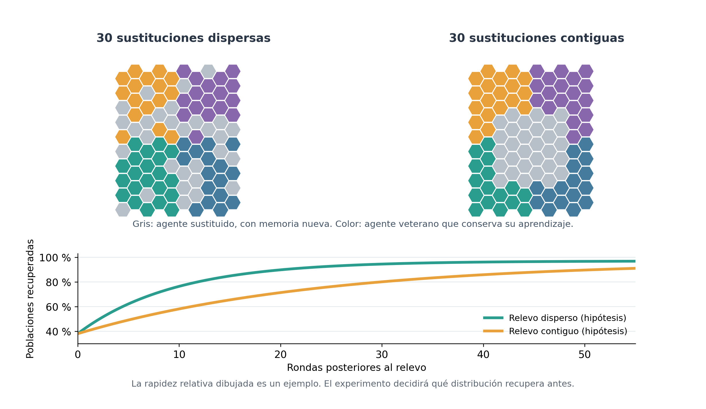

# Memoria y relevo generacional

**¿Qué pierde una comunidad cuando se marcha un tercio de las personas que aprendieron a coordinarse?** Dos grupos pueden resolver igual de bien una tarea antes del relevo. Sustituir a sus miembros permite investigar dónde residía ese saber y qué hace falta para reconstruirlo.

**Alejandro Panera Pascual** · Propuesta de experimento en sociología computacional

[Leer el proyecto en PDF](documentos/Proyecto_Simulacion_Intergeneracional_ASA.pdf) · [Descargar el documento editable](documentos/Proyecto_Simulacion_Intergeneracional_ASA.docx)

*Figura del proyecto. El gris identifica a los recién llegados. Las curvas ilustran una hipótesis y su orden podría invertirse al ejecutar el experimento.*

## La idea del experimento

Cien agentes habitan una malla en la que cada uno ve a seis vecinos. Disponen de dieciséis colores y conocen la meta de usar cuatro en proporciones iguales. Cada agente puede proponer un cambio a un vecino. Quien recibe una propuesta decide qué hacer. El problema es llegar a cuatro grupos de veinticinco sin que nadie asigne colores a la población.

| Momento | Intervención | Qué interesa observar |
| --- | --- | --- |
| Aprendizaje | La penalización depende del tamaño del color propio o del desequilibrio de toda la población. | Qué repertorios de conducta alcanzan un reparto estable y se generalizan a escenarios nuevos. |
| Relevo | Treinta recién llegados ocupan las celdas de veteranos. Las sustituciones pueden estar dispersas o formar una zona contigua. | Cuánto se deteriora la coordinación y cuántas rondas tarda en recuperarse de forma sostenida. |
| Sucesión | Se repite el relevo hasta sustituir a todos los fundadores. | Si las generaciones posteriores conservan la capacidad de reconstruir el reparto. |

## Qué enseñaría la comparación

La parte decisiva empieza **cuando dos comunidades ya coordinan igual de bien**. Si difieren después de un relevo comparable, sus historias de aprendizaje pueden contener información sobre su capacidad de recuperación. El diseño contempla retirar los mensajes, alterar su contenido y mantener una población sin rotación para interpretar esas diferencias.

También plantea buscar *generalización tardía*: una comunidad domina primero situaciones conocidas y solo más adelante consigue organizar poblaciones nuevas. Cada entrenamiento independiente cuenta como una réplica.

## Alcance

La aportación de este trabajo de clase es el diseño experimental. El documento desarrolla las reglas propuestas para NetLogo, los indicadores, los controles y una posible validación con participantes humanos. Las figuras son didácticas. Para interpretar la recuperación conviene registrar por separado la pérdida de memoria y el desequilibrio que introduzca el color inicial de los recién llegados.

## Formalización y simulación

La carpeta [`formalizacion/`](formalizacion/) implementa el diseño, demuestra sus propiedades y
prueba sus predicciones con hipótesis preregistradas (25 de 27 confirmadas). Resultado principal:
la señal colectiva del documento sabe qué tamaño debe tener cada grupo, pero no cuántos grupos debe
haber, y esa información la guarda el vocabulario de la comunidad. Si los recién llegados entran con
colores que ya usa la comunidad, se recupera exactamente cuando los veteranos conservan todas las
categorías, con una tasa que se calcula de antemano. Si entran con cualquier color, la recuperación
se vuelve cientos de veces más lenta, y una sola persona no socializada basta para dejar un quinto
grupo en una de cada cuatro comunidades. Con una señal que cuenta los grupos, la socialización deja
de ser necesaria.
