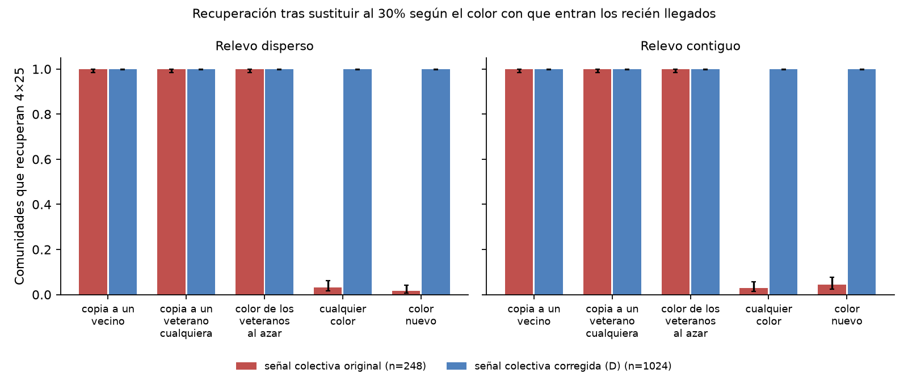

# Formalización y simulación del diseño

Esta carpeta convierte el experimento mental del proyecto en un modelo ejecutable y prueba sus
predicciones con hipótesis preregistradas. Diseño e idea: Alejandro Panera Pascual. Programación
realizada con asistencia de IA.



## Modelo

- Malla hexagonal toroidal de 10×10 (seis vecinos), 16 colores, meta de 4 grupos de 25.
- Agentes con una regla local de ensayo y reversión: si su señal indica malestar, prueban el
  color de un vecino (o uno al azar) y vuelven atrás en el siguiente turno si su señal empeora.
  Su memoria es de un paso y se borra al ser sustituidos.
- Tres señales: **individual** (distancia del tamaño del color propio a 25), **colectiva original**
  (suma de |n − 25| sobre los colores presentes) y **colectiva corregida D** (distancia al reparto
  equilibrado en cuatro grupos más cercano). Variante de **dilema**: cada agente recibe además un
  premio privado por usar su color preferido, con preferencias sesgadas.

## Análisis exacto previo

- La señal individual define un juego de potencial: es un problema de coordinación, no un dilema.
  Tiene una trampa en tres grupos (34/33/33) que es equilibrio.
- La señal colectiva original tiene configuraciones de las que ningún cambio individual mejora
  (por ejemplo, cinco grupos de 20): disolver un grupo sobrante no reduce el coste hasta que se va
  su último miembro.
- La señal D no tiene trampas de un agente.
- En el dilema, el reparto equilibrado se mantiene si el premio privado es menor que 1/N, el coste
  colectivo que cada agente asume al desviarse.

## Resultados

**Aprendizaje (exploratorio).** Agentes Q independientes no resuelven la tarea con ninguna señal.
Con ensayo y reversión, la señal D llega a 4×25 en el 98–100% de las comunidades, la individual
nunca (se queda en 34/33/33) y la colectiva original en el 0–9%.

**Relevo del 30% (preregistrado en `PREREG_C08_RELEVO.md`; 256 comunidades por señal).** 5 de 6
hipótesis confirmadas:

- Con D, todas las comunidades se recuperan, sea el relevo disperso o contiguo y entren los nuevos
  con el color que entren. Los recién llegados que copian a un vecino veterano aceleran la
  recuperación un 30–45%.
- El dilema con premio por debajo del umbral se recupera igual.
- La señal individual sigue atrapada.
- **Refutada:** que un grupo nuevo de recién llegados rompiera la trampa de la señal individual.
  Los miembros del grupo demasiado grande se van a los grupos medianos, que se pasan de tamaño, y
  nadie se une al grupo que se vacía porque eso empeora su propia señal.

**Qué necesita saber un recién llegado (preregistrado en `PREREG_C08B_SOCIALIZACION.md`).** Con la
señal colectiva original y 248 comunidades que ya coordinaban, 5 de 5 hipótesis confirmadas:

| Color de entrada | Recuperan (disperso / contiguo) |
|---|---|
| copia a un vecino veterano | 248/248 · 248/248 |
| copia a un veterano cualquiera | 248/248 · 248/248 |
| uno de los colores de los veteranos, al azar | 248/248 · 248/248 |
| cualquier color | 8/248 · 7/248 |
| un color nuevo | 4/248 · 11/248 |

Lo que transmite la socialización es el **vocabulario** de la comunidad (qué colores existen), no
la proximidad ni las proporciones. La memoria de los agentes no importa en este modelo; decide si la
entrada introduce categorías ajenas. Con relevos sucesivos hasta no dejar ningún fundador, las
comunidades siguen coordinadas. Con la señal D todo se recupera, de modo que **la señal original
es justamente la que hace interesante estudiar la socialización**.

## Alcance

Es un modelo de juguete con una sola regla de aprendizaje: muestra mecanismos posibles, no leyes
sociológicas. Literatura con la que contrastarlo: March (1991) sobre rotación de personal y
aprendizaje organizativo, socialización organizativa (Van Maanen y Schein, 1979) y transmisión
cultural (Boyd y Richerson, 1985).

## Reproducir

Requiere Python 3 con NumPy (y Matplotlib para la figura). Desde esta carpeta:

```
python c08_pilot.py              # aprendizaje con las tres señales
python c08_pilot_dilemma.py      # variante de dilema
python c08_turnover.py           # relevo (≈2 min)
python c08b_confirm.py           # socialización y sucesión (≈40 min)
python c08b_figure.py
```

`FREEZE_C08.txt` y `FREEZE_C08B.txt` guardan las huellas SHA-256 del código y de los preregistros
fijadas antes de ejecutar los análisis principales (`sha256sum -c FREEZE_C08B.txt`).
