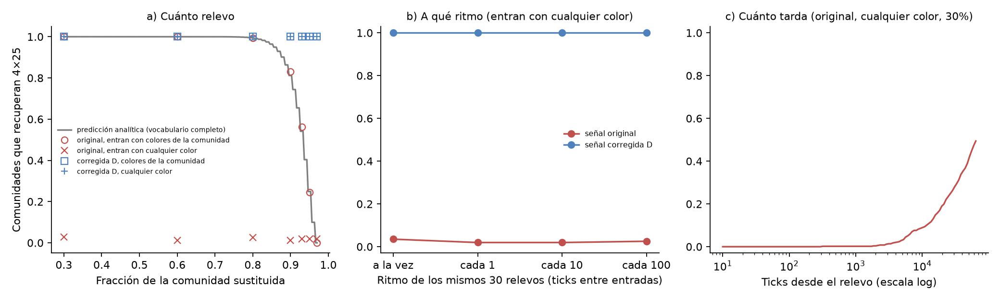

# Formalización y simulación del diseño

Esta carpeta convierte el experimento mental del proyecto en un modelo ejecutable, demuestra sus
propiedades y prueba sus predicciones con hipótesis preregistradas. Diseño e idea: Alejandro Panera
Pascual. Programación realizada con asistencia de IA.

**Resultado central.** La señal colectiva del documento sabe qué tamaño debe tener cada grupo, pero
no cuántos grupos debe haber. Esa información la guarda el **vocabulario** de la comunidad, es
decir, los colores que usan los veteranos. Si los recién llegados entran con colores de la
comunidad, la institución se recupera si y solo si los veteranos conservan todas las categorías, y
la tasa de recuperación se puede calcular de antemano. Con una señal que sí cuenta los grupos, la
socialización deja de ser necesaria: socialización y retroalimentación estructural son sustitutivas.



## Modelo

- Malla hexagonal toroidal de 10×10 (seis vecinos), 16 colores y meta de 4 grupos de 25.
- Agentes con una regla local de ensayo y reversión: si su señal indica malestar, prueban el
  color de un vecino (o uno al azar) y vuelven atrás en el siguiente turno si su señal empeora.
  Su memoria es de un paso y se borra al ser sustituidos.
- Tres señales: **individual** (distancia del tamaño del color propio a 25), **colectiva original**
  C (suma de |n − 25| sobre los colores presentes) y **colectiva corregida D** (distancia al reparto
  equilibrado en cuatro grupos más cercano). Variante de **dilema**: cada agente recibe además un
  premio privado por usar su color preferido, con preferencias sesgadas.

## Teorema

Demostración en [`TEOREMA_C09.md`](TEOREMA_C09.md), comprobada enumerando todos los estados
posibles para seis tamaños de comunidad (`c09_theory.py`).

1. Con exactamente cuatro grupos, la señal original y la corregida coinciden.
2. Con menos grupos de los necesarios, la señal original atrapa a la comunidad: crear un grupo
   siempre empeora la señal, así que una regla que no acepta empeorar nunca lo crea.
3. Con más grupos de los necesarios, la meta es alcanzable, pero a través de **mesetas**: estados
   en los que ningún cambio mejora y hay que vaciar un grupo entero sin que la señal lo premie. Las
   mesetas son exactamente los estados en que todos los grupos tienen como mucho 25 miembros y
   ninguno tiene uno solo.
4. La señal corregida D no tiene trampas ni mesetas.

Además, la señal individual define un juego de potencial con una trampa en tres grupos (34/33/33),
y en el dilema el reparto equilibrado se mantiene si el premio privado es menor que 1/N.

## Resultados

Todas las fases principales están preregistradas, con huellas SHA-256 del código fijadas antes de
ejecutar. En total, 25 de 27 hipótesis confirmadas; las dos refutadas se describen abajo.

**1. Aprendizaje (exploratorio).** Agentes Q independientes no resuelven la tarea con ninguna
señal. Con ensayo y reversión, la señal D llega a 4×25 en el 98–100% de las comunidades, la
individual nunca y la colectiva original en el 0–9%.

**2. Relevo del 30% (`PREREG_C08_RELEVO.md`, 5 de 6).** Con D todas las comunidades se recuperan,
entren los nuevos como entren; los que copian a un veterano aceleran la recuperación un 30–45%. La
señal individual sigue atrapada. **Refutada:** que un grupo nuevo de recién llegados rompiera esa
trampa (el grupo nuevo se vacía y se vuelve a 34/33/33).

**3. Qué necesita saber un recién llegado (`PREREG_C08B_SOCIALIZACION.md`, 5 de 5).** Con la señal
original y 248 comunidades que ya coordinaban:

| Color de entrada | Recuperan (disperso / contiguo) |
|---|---|
| copia a un vecino veterano | 248/248 · 248/248 |
| copia a un veterano cualquiera | 248/248 · 248/248 |
| uno de los colores de los veteranos, al azar | 248/248 · 248/248 |
| cualquier color | 8/248 · 7/248 |
| un color nuevo | 4/248 · 11/248 |

Lo transmitido es el vocabulario, no la proximidad ni las proporciones. Con relevos sucesivos hasta
no dejar ningún fundador, las comunidades siguen coordinadas.

**4. Ley de supervivencia del vocabulario (`PREREG_C09.md`, 12 de 13; 512 comunidades por celda).**

- Si los recién llegados usan colores de la comunidad, la recuperación ocurre exactamente cuando los
  veteranos que quedan conservan los cuatro colores: acuerdo del 100%, comunidad a comunidad, con
  relevos del 30% al 97%, dispersos o contiguos.
- La tasa coincide con la probabilidad hipergeométrica de que los veteranos cubran los cuatro
  colores, calculada antes de simular:

  | Sustituidos | 30% | 60% | 80% | 90% | 93% | 95% | 97% |
  |---|---|---|---|---|---|---|---|
  | Predicción | 1,000 | 1,000 | 0,994 | 0,812 | 0,541 | 0,249 | 0 |
  | Simulación | 1,000 | 1,000 | 0,994 | 0,830 | 0,563 | 0,246 | 0 |

- Con la señal D, todas las comunidades se recuperan en todos los casos, aunque se pierdan
  categorías: la señal las recrea.
- Si los recién llegados traen colores ajenos, la comunidad no queda bloqueada sino en una meseta:
  la mitad se recupera en 64 000 turnos (mediana 26 115, unas 500 veces más que con entrada
  socializada). Si los agentes solo aceptan mejoras estrictas, la meseta se convierte en trampa.
- El patrón se repite con 2 y 5 grupos.
- **Refutada:** espaciar en el tiempo los mismos 30 relevos no ayuda. El color ajeno no desaparece
  rápido: a menudo un vecino lo adopta antes de que su portador lo abandone.

**5. Un solo recién llegado (`PREREG_C09C_UN_RECIEN_LLEGADO.md`, 3 de 3; 1024 comunidades).** Una
única persona que entra con un color propio en una comunidad ya coordinada deja un quinto grupo
persistente de unas 20 personas en el 25,6% de las comunidades con la señal original. No lo logra
por ventaja, sino porque unirse a su grupo no cuesta nada. Con la señal D, nunca.

## Lectura sociológica (para discutir)

La entrada con colores de la comunidad se parece a la socialización serial de Van Maanen y Schein
(1979): los veteranos sirven de modelo. La entrada con colores propios se parece a la disyuntiva.
La señal original equivale a normas de tamaño que cada grupo vigila por su cuenta; la corregida, a un
plano explícito de la estructura, como un organigrama. El modelo predice que, cuando el control es
local y por grupos, la rotación sin socialización multiplica las categorías y vuelve muy lenta la
recuperación, mientras que un plano explícito hace innecesaria la socialización para conservar la
estructura.

## Alcance y antecedentes

Es un modelo de juguete con reglas de búsqueda local: muestra mecanismos posibles, no leyes
sociológicas. El teorema vale para cualquier regla que no acepte empeorar la señal, no para
aprendices que sí la empeoran. Trabajos más cercanos: Harrison y Carroll (1991, 2002; libro de 2006)
sobre transmisión cultural con rotación en organizaciones; Carley (1992) sobre aprendizaje
organizativo y rotación; Zoethout, Jager y Molleman (2010) sobre recién llegados en la asignación
autoorganizada de tareas; Kitts y Trowbridge (2007); modelos de juego de nombres con reemplazo de
población (Colaiori et al., 2015); March (1991). No hemos encontrado trabajos que distingan una
señal que conoce tamaños de una que conoce el número de grupos, ni que prevean la recuperación con
la supervivencia del vocabulario, pero la búsqueda no ha sido exhaustiva.

## Reproducir

Requiere Python 3 con NumPy (y Matplotlib para las figuras). Desde esta carpeta:

```
python c08_pilot.py              # aprendizaje con las tres señales
python c08_pilot_dilemma.py      # variante de dilema
python c08_turnover.py           # relevo (≈2 min)
python c08b_confirm.py           # socialización y sucesión (≈40 min)
python c08b_figure.py
python c09_theory.py             # enumeración exhaustiva del teorema
python c09_experiments.py        # ley del vocabulario, ritmo, horizonte largo, regla estricta, k (≈17 min)
python c09c_single.py            # un solo recién llegado
python c09_figures.py
```

Los archivos `FREEZE_*.txt` guardan las huellas SHA-256 del código y de los preregistros fijadas
antes de ejecutar los análisis principales (`sha256sum -c FREEZE_C09C.txt`). En `FREEZE_C09.txt`,
la ruta `../claude_cycle08/c08_sim.py` corresponde al `c08_sim.py` de esta carpeta (misma huella).
